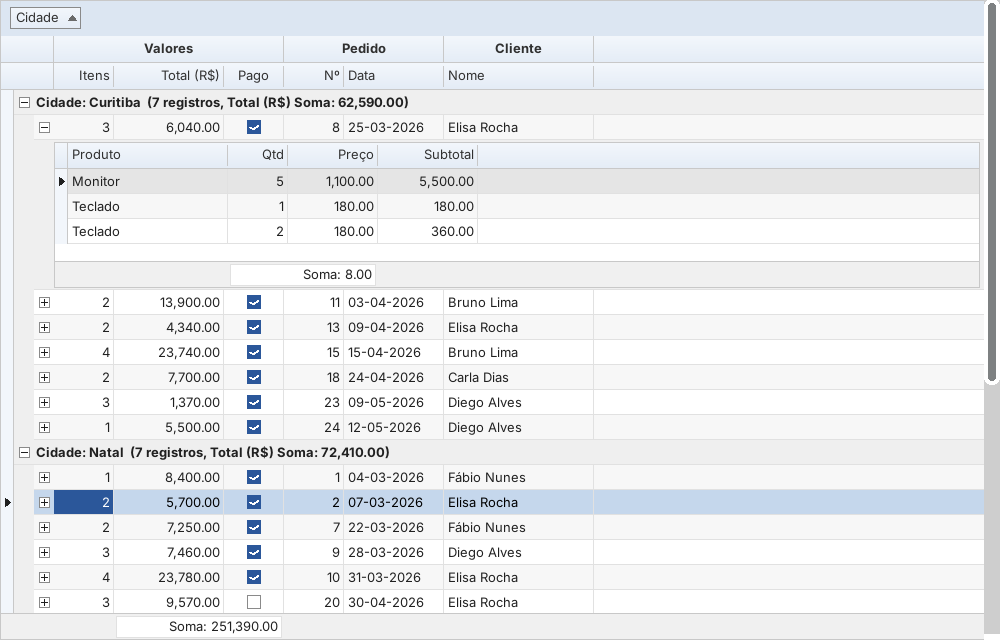

# ESKit

Componentes inspirados no **FireMonkey** (FX), no **DevExpress** (grade com bandas, cartões e mestre-detalhe, editores, NavBar, Ribbon, barra de ferramentas da grade) e no **FireDAC** (acesso a banco), em duas versões:

| Pasta | Ambiente | Pacotes |
|---|---|---|
| [`lazarus/`](lazarus) | Lazarus 3.x/4.x (FPC 3.2.2+), LCL | `eskit.lpk` (runtime + design) e `design/eskitdsgn.lpk` |
| [`delphi/`](delphi) | Delphi 10.x+ (VCL) | `ESKit.dpk` e `ESKitDB.dpk` (runtime) e `dclESKit.dpk` (design) |

## Prefixos

| Prefixo | Origem da ideia | Exemplos |
|---|---|---|
| `TEsFx*` | FireMonkey | `TEsFxRectangle`, `TEsFxButton`, `TEsFxSwitch`, `TEsFxTabControl`, `TEsFxListBox`, `TEsFxFloatAnimation` |
| `TEs*` | DevExpress | `TEsGrid`, `TEsToolBarGrid`, `TEsButtonEdit`, `TEsNavBar`, `TEsRibbon`, `TEsSkinController` |
| `TEs*` (unit `EsDB`) | FireDAC | `TEsConnection`, `TEsQuery`, `TEsTable`, `TEsCommand`, `TEsMemTable` |

A versão Lazarus traz ainda units `Vcl.*`/`System.*` para compilar código Delphi sem mudar os `uses` (`lazarus/delphicompat`) e o comando **Ferramentas › Perfil Delphi (ESKit)...**, que deixa a IDE do Lazarus com encaixe em janela única, cores e fonte do Delphi.

Documentação: [versão Lazarus](lazarus/README.md) (descreve todos os componentes) e [versão Delphi](delphi/README.md) (instalação e diferenças).

## Licença

LGPL modificada (a mesma da LCL): veja `COPYING.modifiedLGPL.txt` e `COPYING.LGPL.txt`.
Os ícones da barra da grade são derivados do [Lucide](https://lucide.dev) (licença ISC), ver `lazarus/images/toolbargrid/LICENSE-lucide.txt`.
