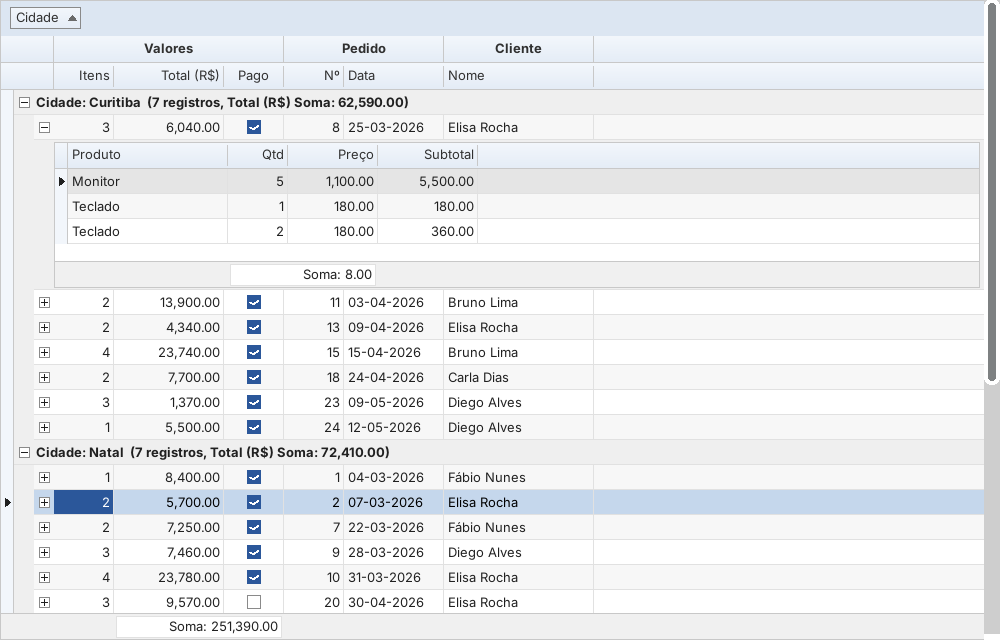
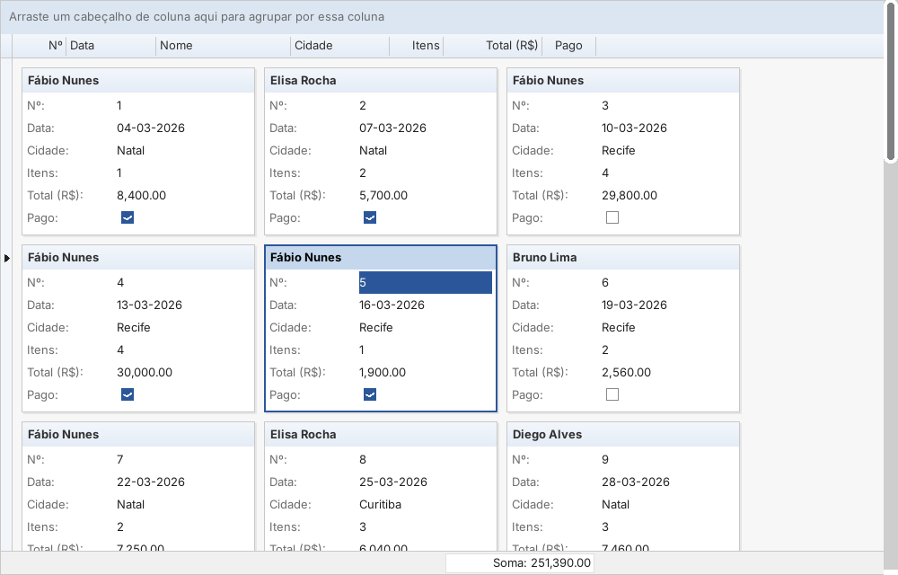
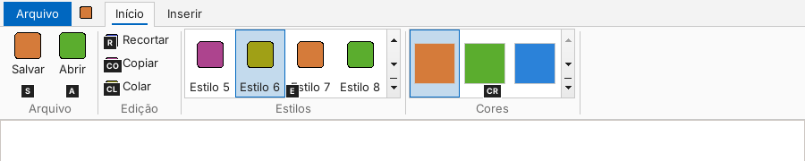
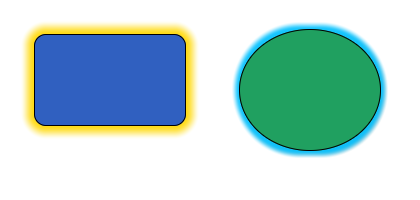
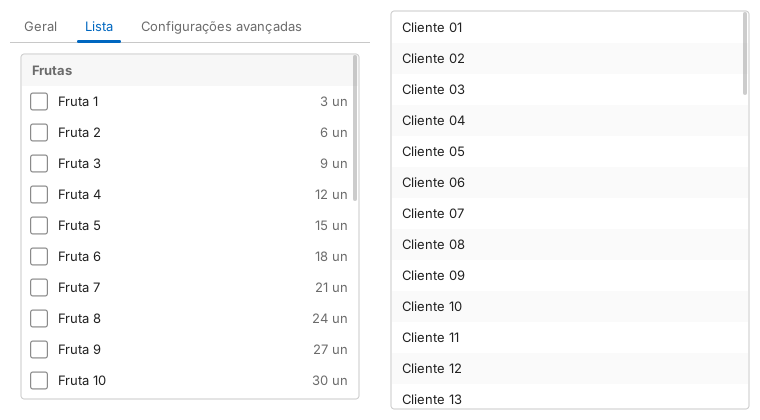
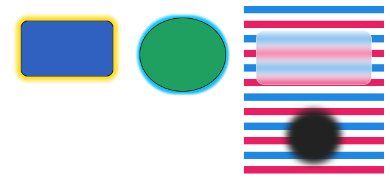

# ESKit para Lazarus

Pacote de componentes que aproxima o Lazarus da experiência do **Delphi**:

* **TEsFx\*** — controles no estilo **FireMonkey (FMX)**: formas vetoriais com anti-aliasing, sombra e brilho (glow), gradientes, animações (`TFloatAnimation`, `TColorAnimation`, `TAnimator`), estilos claro/escuro e controles modernos (Switch, TrackBar, ArcDial, AniIndicator…).
* **TEs\*** — controles no estilo **DevExpress VCL**: grade com agrupamento por arrastar, linha de filtro, painel de pesquisa, sumários, bandas, cartões e mestre-detalhe (cxGrid), editores com botões (cxButtonEdit, cxSpinEdit, cxComboBox, cxDateEdit), NavBar, Ribbon com acesso rápido, galerias, abas contextuais e KeyTips, e *skins* (TdxSkinController).
* **Camada de compatibilidade `FMX.*`** — units `FMX.Types`, `FMX.Objects`, `FMX.StdCtrls`, `FMX.Edit`, `FMX.Layouts`, `FMX.Controls` e `FMX.Ani` com apelidos (`TRectangle`, `TButton`, `TFloatAnimation`, `TAnimator`…) para portar código FMX com menos mudanças.
* **Integração com a IDE** (pacote `ESKitDsgn`): editor de `TAlphaColor` no Inspetor de Objetos e modelos *Projeto › Novo* "Aplicação estilo Delphi (VCL)" e "Aplicação ESKit (FMX + Express)".

Não há nenhuma alteração no Lazarus: é um pacote comum (`eskit.lpk`), instalado como qualquer outro.



| Visão em cartões | Ribbon com KeyTips |
|---|---|
|  |  |

---

## 1. Análise: deixar o Lazarus mais parecido com o Delphi

### 1.1 O que este repositório já oferece (e muita gente não sabe)

| Recurso do Delphi | Equivalente no Lazarus (neste repositório) | Como ativar |
|---|---|---|
| IDE em janela única, painéis acopláveis | `components/anchordocking/design/anchordockingdsgn.lpk` | Pacote › Instalar/Desinstalar pacotes › *AnchorDockingDsgn* › Reconstruir IDE |
| Designer de formulário dentro do editor (abas *Code/Design*) | `components/dockedformeditor/dockedformeditor.lpk` | Instalar *DockedFormEditor* e reconstruir |
| Atalhos de teclado do Delphi (Ctrl+K…, Ctrl+Shift+C, F12…) | esquema **"Classic"** em `ide/keymapping.pp` | Ferramentas › Opções › Editor › Mapeamento de teclas › *Classic* |
| Cores do editor do Delphi | `ide/ColorDelphi.xml` | Ferramentas › Opções › Editor › Exibição › Cores › *Delphi* |
| Tool Palette com busca | janela *Lista de componentes* (`ide/componentlist.pas`) | Exibir › Componentes (Ctrl+Alt+P), acople ao lado direito |
| Importar projetos/units/pacotes Delphi | `converter/` | Ferramentas › Converter projeto/pacote/unit Delphi |
| Sintaxe Delphi | `{$mode delphi}` / `{$mode delphiunicode}` | Projeto › Opções › Opções do compilador › Análise › Modo de sintaxe |

### 1.2 Lacunas que este pacote preenche

| Lacuna | Solução no ESKit |
|---|---|
| Não existe FireMonkey | `TEsFx*`: motor gráfico próprio com anti-aliasing (sem dependências), animações, estilos, sombras, gradientes |
| Não existe suíte DevExpress | `TEs*`: grade, editores, NavBar, Ribbon e skins |
| `TAlphaColor` não tem editor no Inspetor | `EsPropEdits`: nomes, `#AARRGGBB`, amostra de cor, diálogo de cor preservando o alfa |
| LFM grava cores ARGB como número inválido para o leitor do FPC | `RegisterIntegerConsts` grava como o FMX: `Fill.Color = claWhite` / `xFF0067C0` |
| Projeto novo é `{$mode objfpc}` | Modelos "Aplicação estilo Delphi (VCL)" e "Aplicação ESKit", com `{$mode delphi}` no projeto e nas units |
| Código FMX usa `FMX.Objects`, `TRectangle`… | Units de compatibilidade `FMX.*` |
| Código VCL usa `Vcl.Forms`, `System.SysUtils`, `Winapi.Windows`… | Pacote `delphicompat/eskitdelphicompat.lpk`: units `Vcl.*`, `System.*`, `Data.DB`, `Winapi.*` geradas a partir da LCL/RTL (seção 3.7) |
| Configurar a IDE como a do Delphi exige vários passos | **Ferramentas › Perfil Delphi (ESKit)...** aplica tudo de uma vez (seção 2) |

---

## 2. Instalação

1. Clone o repositório (ou copie a pasta `lazarus` deste repositório para onde preferir, por exemplo `lazarus/components/eskit`).
2. No Lazarus: **Pacote › Abrir arquivo de pacote (.lpk)** › `eskit.lpk` › **Compilar**.
3. **Pacote › Abrir arquivo de pacote** › `design/eskitdsgn.lpk` › **Usar › Instalar**. A IDE será reconstruída.
4. Depois de reiniciar, aparecem as páginas **ESKit FMX**, **ESKit FMX Animations** e **ESKit Express** na paleta.

**Perfil Delphi.** Com o `eskitdsgn.lpk` instalado, **Ferramentas › Perfil Delphi (ESKit)...** abre um diálogo com três opções, todas marcadas:

* **IDE em janela única com o designer encaixado**: instala `AnchorDockingDsgn` e `DockedFormEditor` (que vêm com o Lazarus). A IDE pede confirmação e é reconstruída.
* **Esquema de cores "Delphi"** no editor.
* **Fonte do editor como no Delphi**: Consolas 10 (ou Cascadia Mono, DejaVu Sans Mono, Liberation Mono, Courier New, a primeira que existir).

Cores e fonte valem na hora no Lazarus 5.99 em diante, que tem a API para isso. No Lazarus 4.x e 5.0 elas são gravadas na configuração do editor e valem depois de reiniciar a IDE.

Os atalhos padrão do Lazarus já seguem os do Delphi (F9, Ctrl+F9, F7/F8, F12, Ctrl+Shift+C, Ctrl+Clique).

Para o demo: abra `examples/demo/eskitdemo.lpi` e pressione F9. Os demais projetos em `examples/` são testes automáticos que imprimem `OK`/`FALHA` (e salvam capturas na pasta passada como parâmetro).

Requisitos: Lazarus 3.x ou mais recente (testado no trunk 5.99) e FPC 3.2.2 ou mais recente. O código é LCL puro, sem chamadas específicas de plataforma.

---

## 3. Componentes

### 3.1 ESKit FMX (estilo FireMonkey)

| ESKit | Equivalente FMX | Destaques |
|---|---|---|
| `TEsFxStyleBook` | `TStyleBook` | `Style` = Light, Dark, Air, Jet (e skins DevExpress), `AccentColor`, `ApplyToForm`, `StyleFile` (arquivo de tema) e `CustomStyle` (tema embutido no formulário) |
| `TEsFxLayout` | `TLayout` | container invisível (contorno pontilhado em design) |
| `TEsFxRectangle` | `TRectangle` | `Fill`, `Stroke`, `XRadius/YRadius`, `Corners`, `Shadow`, `Glow`, `ThemeFill`; aceita filhos |
| `TEsFxCircle`, `TEsFxEllipse`, `TEsFxLine` | `TCircle`, `TEllipse`, `TLine` | anti-aliasing, gradiente, sombra (`Shadow` = `TShadowEffect`) e brilho (`Glow` = `TGlowEffect`) |
| `TEsFxText` | `TText` | `TextSettings` (HorzAlign/VertAlign = `txLeading`/`txCenter`/`txTrailing`, WordWrap, Trimming, FontColor) |
| `TEsFxButton` | `TButton` | estilos Default/Primary/Outline/Text/Danger/Success, hover e press animados, `Images`, `ModalResult`, `Action` |
| `TEsFxEdit` | `TEdit` | `TextPrompt`, borda arredondada e linha de foco animada |
| `TEsFxSwitch` | `TSwitch` | `IsChecked`, `OnSwitch`, polegar animado |
| `TEsFxCheckBox`, `TEsFxRadioButton` | `TCheckBox`, `TRadioButton` | marca desenhada progressivamente, `GroupName` |
| `TEsFxTrackBar` | `TTrackBar` | `Min/Max/Value/Frequency`, `OnTracking`, teclado e roda do mouse |
| `TEsFxProgressBar` | `TProgressBar` | barra animada até o novo valor |
| `TEsFxArcProgress` | `TArcDial` (visual) | progresso circular com texto |
| `TEsFxAniIndicator` | `TAniIndicator` | spinner animado (`Active`) |
| `TEsFxTabControl` + `TEsFxTabItem` | `TTabControl` + `TTabItem` | abas em cima, embaixo, sem cabeçalho ou com pontos (`TabPosition` = `tpTop`/`tpBottom`/`tpNone`/`tpDots`), `FullSize`, `Images`, `SetActiveTabWithTransition` (deslizamento animado), `Next`/`Previous`; clique nas abas também no designer, editor com "Nova aba" |
| `TEsFxListBox` | `TListBox` (com `TListBoxItem`) | itens com `Text`, `Detail`, `ImageIndex`, `Accessory` e cabeçalhos de grupo (`IsHeader`), `ShowCheckboxes`, `MultiSelect`, linhas alternadas, rolagem suave e cinética (arrastar com o dedo/mouse), busca incremental pelo teclado, `ScrollToItem` |
| `TEsFxFloatAnimation` | `TFloatAnimation` | `PropertyName` com caminho (`'Fill.Color'`, `'Opacity'`, `'Width'`…), `Trigger`, `AutoReverse`, `Loop`, `Delay`, 11 interpolações × In/Out/InOut |
| `TEsFxColorAnimation` | `TColorAnimation` | anima `TAlphaColor` e `TColor` |
| `TEsFxAnimator` | `TAnimator` | `TEsFxAnimator.AnimateFloat(Botao, 'Opacity', 0.3, 0.4, atOut, itBack)` |

Como funciona: cada controle FX desenha numa superfície em memória (`TEsSurface`) com rasterização por *signed distance fields*, e só então copia um bitmap para o Canvas. Assim o resultado é idêntico em Windows, GTK, Qt e Cocoa. Um controle FX dentro de outro "enxerga" o desenho do pai (transparência real, como no FMX). Só as bordas de cada forma passam pela função de distância; o miolo é preenchido linha a linha por um caminho rápido (uma cena Full HD com retângulos, elipses, contornos e sombra leva cerca de 50 ms num núcleo).



```pascal
EsFxRectangle1.Glow.Enabled := True;
EsFxRectangle1.Glow.GlowColor := TAlphaColors.Gold;
EsFxRectangle1.Glow.Softness := 12;
```



```pascal
EsFxTabControl1.TabPosition := tpBottom;
EsFxTabControl1.SetActiveTabWithTransition(TabLista);   // ttSlide, tdNormal
with EsFxListBox1.Items.Add do begin Text := 'Frutas'; IsHeader := True; end;
with EsFxListBox1.Items.Add do begin Text := 'Maçã'; Detail := '3 un'; end;
```

**Desfoque.** Todas as formas têm `Blur` (desfoca a própria forma, como o `TBlurEffect`) (`Enabled`, `Softness`) e `BackgroundBlur` (raio do vidro fosco: desfoca o que está atrás, dentro da forma, como o `TBackgroundBlurEffect`; 0 = desligado; use com `Fill` semitransparente). "O que está atrás" inclui o pai e os irmãos FX que ficam por baixo, então formas sobrepostas se enxergam como no FMX.



```pascal
Vidro.Fill.Color := $80FFFFFF;
Vidro.BackgroundBlur := 10;
Bola.Blur.Enabled := True;
Bola.Blur.Softness := 8;
```

#### Temas em arquivo (no lugar dos `.style` do FMX)

Os temas são arquivos de texto (`.estheme`, formato INI) com o estilo base e as cores; chaves ausentes vêm do estilo base, então um tema pode alterar só o destaque:

```ini
[ESKitTheme]
Base=Dark
Accent=#FF8800
Radius=6
```

```pascal
EsThemes.ApplyStyle(dsOffice2019Black, TAlphaColors.Crimson);
EsThemes.SaveToFile('meu.estheme');     // exporta o tema atual (todas as cores)
EsThemes.LoadFromFile('meu.estheme');   // aplica a todos os controles ESKit
EsFxStyleBook1.StyleFile := 'meu.estheme';      // lido ao abrir o formulário
EsFxStyleBook1.LoadStyleFromFile('meu.estheme'); // ou embutido no .lfm (CustomStyle)
EsSkinController1.SkinFile := 'meu.estheme';
```

### 3.2 ESKit Express (estilo DevExpress)

| ESKit | Equivalente DevExpress | Destaques |
|---|---|---|
| `TEsSkinController` | `TdxSkinController` | Office 2019 White/Colorful/Black, The Bezier, Basic (e os estilos FMX); `SkinFile` |
| `TEsGrid` | `TcxGrid` + TableView / BandedTableView / CardView | `ViewMode` = tabela, bandas ou cartões; mestre-detalhe (`DetailGrid`); painel de agrupamento (arrastar cabeçalho), grupos multinível com sumário, ordenação multi-coluna (Shift+clique), linha de filtro (`contém`, `=`, `<>`, `>`, `<`, `>=`, `<=`), painel de pesquisa com realce (Ctrl+F), rodapé e grupos com vários sumários por coluna (`FooterSummaries`/`GroupSummaries`: Registros/Soma/Média/Mín/Máx), multisseleção (`MultiSelect`: Ctrl/Shift+clique, Ctrl+A, Espaço), `StoreToIniFile`/`RestoreFromIniFile`, mover/redimensionar colunas, melhor ajuste, menu de cabeçalho, checkbox para booleanos, edição in-place, `OnCustomDrawCell`, Ctrl+C |
| `TEsToolBarGrid` | `TToolBarGrid` (seu componente) | barra para a `TEsGrid`, ver seção 3.3 |
| `TEsButtonEdit` | `TcxButtonEdit` | coleção `Buttons` (Ellipsis, Down, Glyph, Text, Clear, Search…), Ctrl+Enter |
| `TEsSpinEdit` | `TcxSpinEdit` | inteiro/float, auto-repetição, PgUp/PgDn, roda do mouse |
| `TEsComboBox` | `TcxComboBox` | auto-completar, lista fixa ou editável, Alt+↓/F4 |
| `TEsDateEdit` | `TcxDateEdit` | calendário suspenso com Hoje/Limpar, `+`/`-` muda o dia |
| `TEsButton` | `TcxButton` | `Kind` = Standard/DropDown/DropDownButton com `DropDownMenu` |
| `TEsGroupBox` | `TcxGroupBox` | cabeçalho skinado, recolhível |
| `TEsNavBar` | `TdxNavBar` | grupos recolhíveis, item selecionado, ícones |
| `TEsRibbon` | `TdxRibbon` | botão de aplicação, abas, grupos, botões grandes/pequenos, check, dropdown, galerias (`rbsGallery`), barra de acesso rápido (`QuickAccessItems`, na barra de abas ou abaixo), abas contextuais (`ContextCaption`/`ContextColor` + `ShowContext`), KeyTips (Alt ou F10), menu de personalização (botão direito), minimizar (duplo clique na aba) |

#### Grade: modo não vinculado

```pascal
Grid.DataController.BeginUpdate;
try
  R := Grid.DataController.AppendRecord;
  Grid.DataController.Values[R, 0] := 'Brasil';
  Grid.DataController.Values[R, 1] := 1250.50;
finally
  Grid.DataController.EndUpdate;
end;
Grid.GroupBy(Grid.Columns[0]);          // agrupa por país
Grid.Columns[1].SummaryKind := skSum;   // soma no rodapé e nos grupos
Grid.OptionsView.Footer := True;
```

#### Grade: modo vinculado (DataSet)

```pascal
EsGrid1.DataSource := DataSource1;  // colunas criadas automaticamente a partir dos campos
```

Como no cxGrid (modo padrão), os registros são carregados em memória para permitir agrupar, filtrar e ordenar. O registro focado é sincronizado com o `DataSet`, e as edições são gravadas com `Edit`/`Post`.

#### Grade: bandas, cartões e mestre-detalhe

```pascal
// bandas (BandedTableView): cada coluna aponta para uma banda
Grid.Bands.Add.Caption := 'Pedido';
Grid.Bands.Add.Caption := 'Cliente';
Grid.Columns[0].BandIndex := 0;
Grid.Columns[1].BandIndex := 1;      // arrastar o título da banda reordena as bandas

// cartões (CardView)
Grid.ViewMode := gvmCards;
Grid.OptionsCard.CardWidth := 260;
Grid.OptionsCard.TitleField := 'Cliente';

// mestre-detalhe: Itens é uma grade (invisível) com todos os itens;
// cada pedido expandido ganha uma grade filha filtrada pela chave
Pedidos.DetailGrid := Itens;
Pedidos.MasterKeyField := 'Pedido';
Pedidos.DetailKeyField := 'Pedido';
Pedidos.ExpandDetail(0);              // ou o botão [+], ou a tecla + do teclado numérico
```

As colunas, os sumários e os formatos do detalhe vêm da grade modelo; editar uma célula na grade filha grava no modelo. Em vez de uma grade modelo, `OnGetDetailRecords` pode preencher cada detalhe (por exemplo com uma consulta ao banco). O menu do cabeçalho troca a visão (tabela/bandas/cartões) e recolhe os detalhes; `StoreToIniFile` grava também a visão e as bandas. A exportação (Excel, PDF, HTML) inclui a linha das bandas.

#### Ribbon: acesso rápido, galerias, abas contextuais e KeyTips

```pascal
Ribbon.AddToQuickAccess(BtnSalvar);            // ou botão direito > "Adicionar..."
Ribbon.QuickAccessPosition := qapBelow;

Estilos := Grupo.Items.Add;
Estilos.ButtonStyle := rbsGallery;
Estilos.GalleryColumns := 4;
Estilos.Gallery.Add.Caption := 'Título';        // ImageIndex ou Color (amostra de cor)
Ribbon.OnGalleryClick := @EstiloEscolhido;      // (Sender, AItem, AIndex)

TabDesign.ContextCaption := 'Ferramentas de Tabela';
TabDesign.ContextColor := TAlphaColors.Seagreen;
Ribbon.ShowContext('Ferramentas de Tabela', True, True);  // mostra e ativa

BtnSalvar.KeyTip := 'S';    // sem KeyTip: letras da legenda, sem repetir
```

### 3.3 TEsToolBarGrid (porte do TToolBarGrid / ToolBarGrid React)

Barra de ferramentas ligada a uma `TEsGrid`, com os mesmos botões, mensagens e regras de habilitação. Os ícones são equivalentes de uso livre, baseados no [Lucide](https://lucide.dev) (licença ISC, uso comercial permitido), em PNG 16/24/32 px. Os grupos de botões são os mesmos do componente Delphi e da versão React:

| Grupo | Botões | Regra |
|---|---|---|
| Layout | Ajustar colunas, Salvar / Carregar / Apagar layout | ícone ✓ à direita quando existe layout salvo |
| Seleção | Mudar tipo de seleção, Selecionar todos, Limpar seleção | selecionar/limpar só em multisseleção |
| Sumários | Contar registros, Somar coluna, Somar agrupamento, Média da coluna, Média do grupo, Remover sumários | desabilitados em multisseleção; os de grupo exigem agrupamento; soma/média só em colunas numéricas (coluna focada) |
| Grupos | Expandir / Retrair agrupamento | exigem agrupamento |
| Impressão | Imprimir grid, Configuração da impressora | orientação, papel (A4/Carta/Ofício) e impressora |
| Exportação | Excel (.xlsx), PDF, HTML, CSV, texto, XML | registros filtrados na ordem da grade, colunas agrupadas primeiro, rodapé com sumários, linha de bandas |

```pascal
ToolBarGrid1.Grid := EsGrid1;
ToolBarGrid1.User := 'usuario';            // carrega o layout salvo deste usuário
ToolBarGrid1.CompanyName := 'Minha Empresa';
ToolBarGrid1.TitleReport := 'Pedidos';
```

| Delphi (`TToolBarGrid`) | React | Lazarus (`TEsToolBarGrid`) |
|---|---|---|
| `TcxGridDBTableView` | `useDataGrid()` + `<DataGrid>` | `TEsGrid` (vinculada a DataSet ou não) |
| `User`, `TitleReport`, `CompanyName` | props | propriedades publicadas |
| `.ini` ao lado do exe | `localStorage` | `<LayoutDirectory>\<User>_<GridId>.ini` (padrão: pasta do exe) |
| `TdxComponentPrinter` / PageSetup | impressão do navegador | `Printer` (Printer4Lazarus) + diálogo de configuração |
| `ExportGridTo*` | SheetJS, jsPDF… | gerador próprio, sem dependências externas (`EsGridExport`) |
| `ShowMessage` | `onMessage` | `OnMessage` (opcional; padrão `ShowMessage`) |

Extras: `VisibleButtons` (escolher botões), `OnButtonClick` (tratar/cancelar a ação de um botão), `OnBeforeExport` (trocar nome do arquivo/cancelar), `AskFileName`, `OpenAfterExport`, `PrintOrientation`, `PaperSize`, e os métodos `SaveLayout`, `LoadLayout`, `Print`, `ExportTo(Formato, Arquivo)`.

A unit `EsGridExport` também pode ser usada sem a barra: `EsExportGrid(EsGrid1, sefExcel, 'dados.xlsx', EsDefaultReportOptions)`.

**PDF e Unicode.** Quando todo o texto cabe no Windows-1252 (português e demais línguas latinas), o PDF usa as fontes padrão Helvetica e fica com poucos KB. Se aparecer qualquer outro caractere (grego, cirílico, hebraico, árabe, chinês, símbolos), o PDF embute automaticamente um subconjunto de uma fonte TrueType do sistema (Arial, Liberation Sans ou DejaVu Sans), com tabela ToUnicode para copiar e pesquisar o texto. Caracteres que essa fonte não tem são buscados em fontes de reserva do sistema (DejaVu, Segoe UI Symbol, Microsoft YaHei, Noto…, inclusive coleções `.ttc`), e trechos em hebraico ou árabe são postos na ordem visual. Para escolher a fonte: `PdfFontMode` (`pfmAuto`/`pfmStandard`/`pfmEmbedded`) e `PdfFontFile` em `TEsReportOptions` ou na `TEsToolBarGrid`.

### 3.5 ESKit DB (estilo FireDAC)

Unit `EsDB`, construída sobre o SQLDB do Free Pascal. As bibliotecas cliente (`sqlite3.dll`, `libpq.dll`, `fbclient.dll`, `libmysql.dll`…) só são carregadas ao conectar.

| ESKit | FireDAC | Observação |
|---|---|---|
| `TEsConnection` | `TFDConnection` | `DriverID` = `SQLite`, `PG`, `FB`/`IB`, `MySQL`, `MSSQL`, `Sybase`, `ODBC`; transação interna automática; `StorePassword` |
| `TEsTransaction` | `TFDTransaction` | opcional |
| `TEsQuery` | `TFDQuery` | `Post`/`Delete` gravam e fazem commit na hora; `CachedUpdates` + `ApplyAndCommit`; `FetchAll` (busca sob demanda) |
| `TEsTable` | `TFDTable` | `TableName` (lista as tabelas no Inspetor de Objetos com a conexão ativa) |
| `TEsCommand` | `TFDCommand` | `CommandText` com `:parametros`, `Execute` devolve as linhas afetadas |
| `TEsMemTable` | `TFDMemTable` | dataset em memória; `CopyDataSet` |

```pascal
EsConnection1.DriverID := 'SQLite';
EsConnection1.DatabaseName := 'dados.db';
EsConnection1.ExecSQL('insert into cliente (nome) values (:nome)', ['Ana']);
Total := EsConnection1.ExecSQLScalar('select count(*) from cliente');

EsQuery1.Open('select * from cliente where cidade = :c', ['Recife']);
DataSource1.DataSet := EsQuery1;   // EsGrid1.DataSource := DataSource1

EsConnection1.StartTransaction;
try
  EsConnection1.ExecSQL('update conta set saldo = saldo - 10 where id = 1');
  EsConnection1.ExecSQL('update conta set saldo = saldo + 10 where id = 2');
  EsConnection1.Commit;
except
  EsConnection1.Rollback;
  raise;
end;
```

Fora de uma transação explícita, `ExecSQL`, `Open`, `Refresh` e `ApplyUpdates` fazem commit sozinhos (`AutoCommit`, como no FireDAC). `TEsDatabase` e `TEsDataSet` continuam existindo como apelidos de `TEsConnection` e `TEsMemTable`.

* **Parâmetros por nome**, em qualquer ordem: `ExecSQL('update cliente set nome = :nome where id = :id', ['id', 'nome'], [7, 'Ana'])`; também em `ExecSQLScalar` e `TEsQuery.Open`/`ExecSQL`. Na forma só com valores, os parâmetros seguem a ordem em que cada nome aparece pela primeira vez no SQL (um nome repetido é um único parâmetro); valores a mais geram erro.
* **Busca sob demanda**: com `FetchAll = False` a consulta traz `PacketRecords` registros por vez; a transação de leitura fica aberta até o `Close`, e as gravações automáticas feitas nesse meio tempo usam `CommitRetaining` (gravam sem fechar o cursor). Com `FetchAll = True` (padrão) todos os registros vêm na abertura e a transação é encerrada na hora.
* **Senha**: por padrão (`StorePassword = False`) a senha não é gravada no `.lfm`; defina-a em código ou no `OnLogin`.

### 3.6 Compatibilidade FMX

```pascal
uses FMX.Types, FMX.Objects, FMX.StdCtrls, FMX.Ani;

procedure TForm1.Button1Click(Sender: TObject);
begin
  Rectangle1.Fill.Color := TAlphaColors.Dodgerblue;
  TAnimator.AnimateFloat(Rectangle1, 'Opacity', 0.5, 0.3);
end;
```

São apenas apelidos de tipo (`FMX.TabControl` e `FMX.ListBox` incluídos). Enumerações *scoped* do FMX (`TAnimationType.Out`) usam os nomes do ESKit (`atOut`).

### 3.7 Compatibilidade VCL (`delphicompat`)

O pacote `delphicompat/eskitdelphicompat.lpk` (separado do ESKit; instale ou só adicione ao projeto) traz units com os nomes do Delphi — `Vcl.Forms`, `Vcl.StdCtrls`, `Vcl.ExtCtrls`, `Vcl.ComCtrls`, `Vcl.Grids`, `Vcl.Dialogs`, `Vcl.Graphics`, `Vcl.Menus`, `Vcl.Samples.Spin`…, `System.SysUtils`, `System.Classes`, `System.Math`, `System.StrUtils`, `System.DateUtils`, `System.Types`, `System.Variants`, `Data.DB`, `Winapi.Windows`, `Winapi.Messages` e outras (35 no total) — que reexportam as classes, tipos, constantes, funções e *resourcestrings* da LCL/RTL. Assim, código VCL compila sem trocar os `uses`:

```pascal
uses
  Winapi.Windows, Winapi.Messages, System.SysUtils, System.Classes,
  Vcl.Graphics, Vcl.Controls, Vcl.Forms, Vcl.StdCtrls;

procedure WMSize(var Msg: TWMSize); message WM_SIZE;   // TWM*/WM_* apelidam TLM*/LM_*
```

As units são geradas por `tools/genvclcompat.py`, que lê a interface das units compiladas (`ppudump`) e copia as declarações dos fontes. O que no fonte original depende da plataforma ou do processador (`{$ifdef windows}`, `{$ifdef FPC_HAS_TYPE_EXTENDED}`…) leva a mesma condição, e cada nome vindo da LCL só é reexportado se existir na versão do Lazarus em uso (`{$if declared(...)}`): o pacote foi compilado para Windows 64 bits e Linux e serve do Lazarus 4.0 em diante. Com `--baseline`, o gerador recebe os fontes de versões mais antigas do Lazarus e deixa de fora as rotinas da LCL que mudaram de assinatura entre elas (as units atuais foram geradas com o 4.0 e o 4.8 como base). Para regerar:

```
python3 tools/genvclcompat.py --lazarus /caminho/lazarus --fpcsrc /caminho/fpc/source \
    --ppudump ppudump --lclunits /caminho/lazarus/lcl/units/x86_64-linux \
    --fpcunits /caminho/fpc/units/x86_64-linux \
    --baseline /caminho/lazarus-4.0 /caminho/lazarus-4.8
```

O exemplo `examples/delphicompat/delphiapp.dpr` é um programa escrito como no Delphi (`.dpr`, `{$R *.dfm}`, `uses Vcl.*`) compilado pelo Lazarus. Diferenças de comportamento entre LCL e VCL continuam valendo (por exemplo, mensagens Windows só existem no Windows; nas outras plataformas valem as mensagens LM_* da LCL).

---

## 4. Estrutura

```
lazarus/
  eskit.lpk                pacote de runtime + design (componentes)
  source/
    esgraphics.pas             TAlphaColor, TEsSurface (rasterizador AA), streaming das cores
    estheme.pas                motor de temas compartilhado
    esfxbase.pas                 TEsFxBrush/Stroke/Shadow/TextSettings, bases, ticker
    esfxanimations.pas           animações e TEsFxAnimator
    esfxshapes.pas               Rectangle, Circle, Ellipse, Line, Text, Layout
    esfxstdctrls.pas             Button, Edit, Switch, CheckBox, Radio, TrackBar, Progress…
    esfxlists.pas                TabControl/TabItem e ListBox
    esskins.pas                TEsSkinController + glifos
    eseditors.pas              ButtonEdit, SpinEdit, ComboBox, DateEdit, Button, GroupBox
    esgrid.pas                 TEsGrid
    esnavbar.pas, esribbon.pas
    esgridexport.pas           exportação xlsx/pdf/html/csv/xml/txt + motor de relatório
    estruetype.pas             leitura e subconjunto de fontes TrueType (PDF Unicode)
    estoolbargrid.pas          TEsToolBarGrid
    esdb.pas                   componentes de banco estilo FireDAC (sobre SQLDB)
    eskitreg.pas           registro na paleta
    compat/fmx.*.pas           apelidos FMX
  design/eskitdsgn.lpk     editores (TAlphaColor, DriverID, TableName, TabControl, ListBox), modelos de projeto e Perfil Delphi
  delphicompat/                units Vcl.*/System.*/Data.DB/Winapi.* (eskitdelphicompat.lpk)
  images/                      ícones da paleta (gen_icons.py gera os PNG; .res pronto)
  images/toolbargrid/          ícones da TEsToolBarGrid: svg, build_icons.py (gera png + .res a partir do Lucide), LICENSE-lucide.txt
  examples/demo/               demo completo (Ribbon + NavBar + grade + FMX + editores)
  examples/gridviews/          testes da grade: bandas, cartões, mestre-detalhe e exportação
  examples/ribbon/             testes do Ribbon: acesso rápido, galerias, contextos, KeyTips
  examples/dbtest/             testes da EsDB (SQLite)
  examples/toolbargrid_test/   testes da TEsToolBarGrid
  examples/fxlists/            testes de TEsFxTabControl e TEsFxListBox
  examples/fxeffects/          testes de brilho, desfoque, vidro fosco e temas em arquivo
  examples/pdfunicode/         testes do PDF Unicode (subconjunto de fontes, hebraico, árabe)
  examples/delphicompat/       programa estilo Delphi compilado com as units Vcl.*
  docs/screenshots/            imagens deste README
```

---

## 5. Observações

* **Desenho por software.** Os controles FX são rasterizados pelo próprio ESKit (sem GPU), o que garante o mesmo resultado em todas as plataformas. O interior das formas é preenchido por um caminho rápido, então controles de tamanho normal e animações são fluidos; uma forma ocupando a tela inteira repintada a 60 quadros por segundo ainda usa CPU de forma perceptível.
* **3D.** O ESKit não tem equivalente ao `TViewport3D`/`TModel3D` do FMX e não pretende ter: 3D exige um motor gráfico (OpenGL/Vulkan) e foge do escopo de uma biblioteca de componentes. Para 3D no Lazarus, use o `TOpenGLControl` (pacote `LazOpenGLContext`) ou o Castle Game Engine.
* **Temas.** Os arquivos `.estheme` substituem os `.style` do FMX, mas não leem `.style` (o formato do FMX descreve árvores de objetos do próprio FMX).
* **Editores.** `TEsFxEdit` e os editores `TEs*` usam um `TEdit` nativo por dentro, de propósito: assim funcionam IME, corretor, acessibilidade e menus de contexto do sistema.
* **Impressão.** Usa o pacote padrão `Printer4Lazarus`, que é dependência do ESKit.
* **PDF.** O árabe (inclusive as letras do persa e do urdu) sai com as formas contextuais corretas (inicial, medial, final, isolada) e as ligaduras lam-alef, e o texto copiado do PDF volta às letras originais. A ordem visual de hebraico e árabe é simplificada (os trechos da direita para a esquerda são invertidos, sem o algoritmo bidirecional completo). Escritas que exigem *shaping* complexo de outro tipo (devanágari, tailandês) saem sem ligaduras.
* **Ícones.** Os ícones da `TEsToolBarGrid` são derivados do Lucide (licença ISC): ao redistribuir, mantenha `images/toolbargrid/LICENSE-lucide.txt`.
* **`TEsSortOrder`** usa os valores `esoNone`, `esoAscending` e `esoDescending` (o prefixo evita conflito com `soAscending` da unit `Grids`).
* **Validação.** Feita com FPC 3.2.2 + Lazarus trunk (5.99) em Linux/GTK3: pacotes compilados, IDE reconstruída com o pacote, componentes inseridos no designer e testes automáticos em `examples/` (grade, Ribbon, banco, barra da grade, abas e listas FX, efeitos, PDF Unicode, compatibilidade VCL) e Perfil Delphi executado na IDE (cores, fonte e instalação do encaixe com reconstrução). No Windows, compile o pacote pelo Lazarus antes de usar.

Licença: LGPL modificada (a mesma da LCL).
